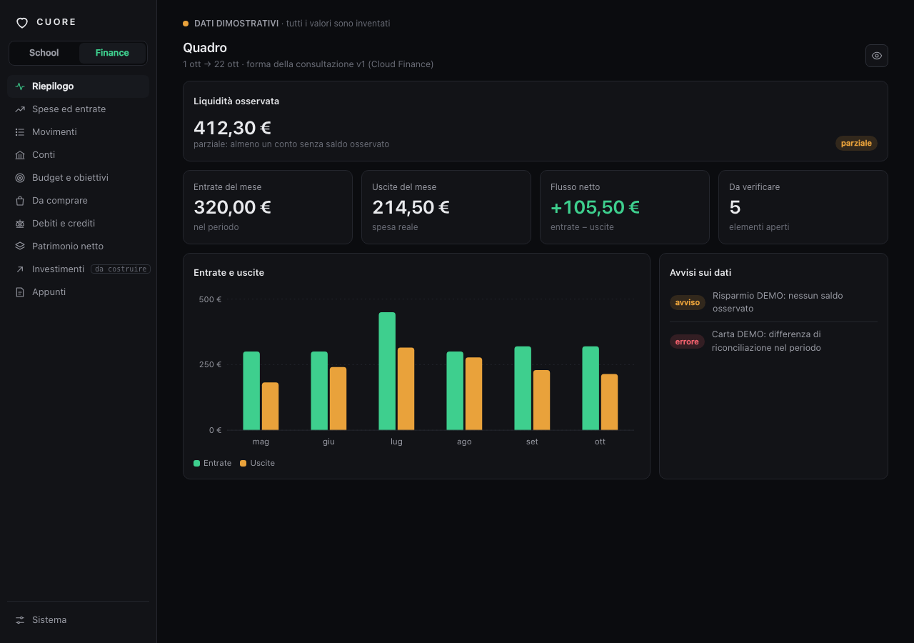
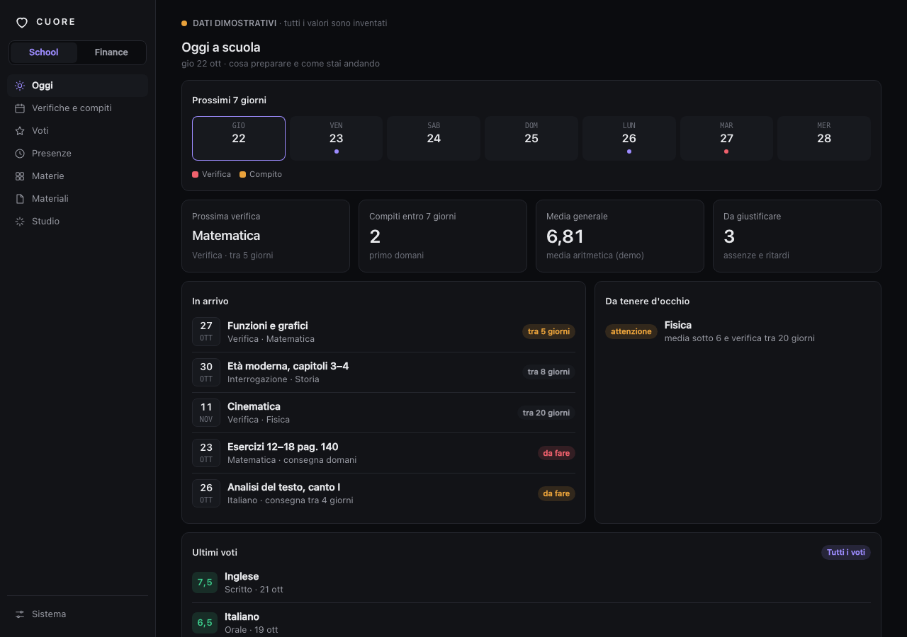
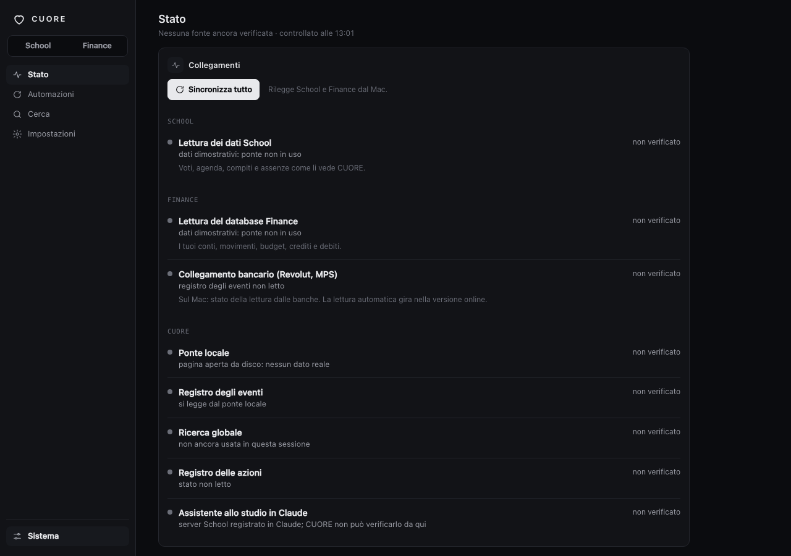
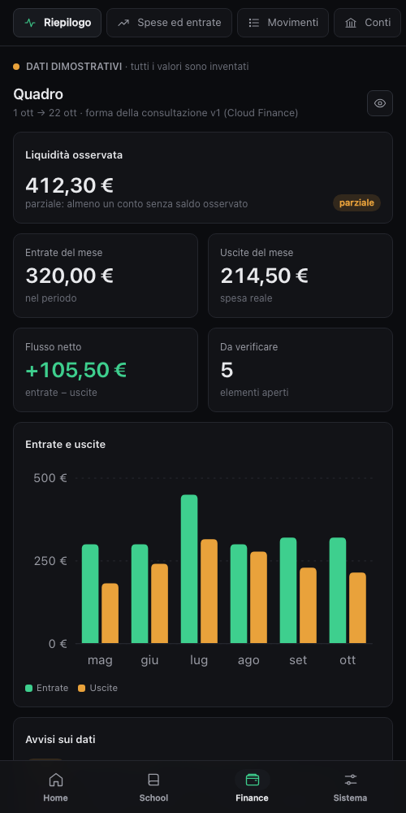
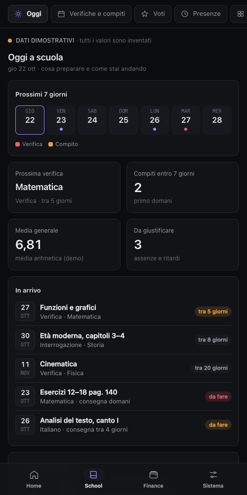

# CUORE

A personal life dashboard for **iPhone, iPad and Mac**: **school** (grades, homework, tests, absences, teacher notices,
class materials) and **money** (bank accounts, cash, budgets, credits and debts) in one installable web app. It works
**with the Mac switched off**, keeps the two areas strictly separated, and costs **€0/month** on Cloudflare's Free plan.

> Built and used every day by a student to run school and personal finances. Published as a **reference
> implementation and a starting point**: take the parts you need — the finance engine, the school sync, the cloud
> layer, the UI, the automations — and adapt them to your life. Nothing personal is included: all data in this
> repository is invented.

| Finance | School | System status |
|---|---|---|
|  |  |  |

| Phone: Finance | Phone: School |
|---|---|
|  |  |

Try it in 10 seconds: open `app/index.html` in a browser. It runs on invented demo data, with no server and no network.

**Want your own CUORE?** Follow the step-by-step guide: **[docs/SETUP.md](docs/SETUP.md)** (demo → check → school → money → your own Cloudflare → bank → Claude). Each stage works on its own.

**Want to grow it?** [docs/EXTENDING.md](docs/EXTENDING.md) lists the extension points: a new bank, a new school source, a new dashboard card, an automation, a Claude tool, a database migration.

## The story: how this was built

CUORE started as two separate personal tools: a script to keep track of my bank accounts and a way to see my school
register in one place. They were useful but scattered, so I merged them into one app with one rule:
**school and money are two engines that never share data.** Early versions kept school data in Notion; I dropped that
for a local append-only database (the *Registry*) because I wanted nothing the school deletes to ever be lost, and
nothing to depend on a third-party workspace.

I am a student, not a professional programmer. I decided **what** the app had to do and **why**; **Claude Code**
(Anthropic's coding agent) designed and wrote almost all of the code, and I reviewed the results on my own devices.
The way of working is part of the project, and you can reuse it:

- **Plan, then build.** For every bigger piece: explore the code, write a plan, criticise it, agree, then execute.
- **Small blocks with a checkpoint.** Each block ends with all checks green, a short report and a saved state, so a
  session that dies (or a closed laptop) loses nothing.
- **Evidence before claims.** `npm run verifica` runs type checks, lint, migrations and over a thousand tests; nothing is
  called «working» without a command that proves it. A separate read-only reviewer agent looks for leaked secrets
  and personal data before anything is published.
- **Never test on real data.** Every try-out of the bank sync or the importer runs on a *copy* of the database, and
  every write to real data is append-only with a reason, a backup and an atomic swap.
- **The agent proposes, the owner approves.** Anything that changes data or configuration is a *proposed action* that
  I approve before it runs (see the `cuore` MCP server below).

**What you get when you download it.** A working engine, not a mock-up: the finance engine, the school Registry, the
Worker, the UI and all automations run from a fresh clone, and the full check suite passes on invented data. What it
cannot ship is *your* life: your bank consent, your school credentials, your Cloudflare account. Those you plug in
(next sections). Until you do, it runs as a demo with synthetic data, and it says so on screen.

## The connectors

| Connector | What it reads | How it is wired |
|---|---|---|
| **ClasseViva** (Italian school register) | grades, absences, homework, tests, notices, lessons, class materials | read-only client in `scuola/mcp/classeviva/`; credentials only in the macOS Keychain; a job on the Mac writes the Registry and sends a *derived feed* (never credentials) to the Worker |
| **Google Classroom** | courses, topics, assignments, announcements, links to the original materials | read-only, separate source: records are never silently merged with ClasseViva's (`app/bridge/cuore_classroom.py`) |
| **Revolut** and **Monte dei Paschi** | balances and transactions of the author's accounts | through the open-banking API of Enable Banking (below), not by scraping |
| **Claude (MCP)** | search, events, study help | two MCP servers: `classeviva` (read-only tools) and `cuore` (search, events, proposed actions) |

**Search.** One search engine (`app/bridge/cuore_search.py`) serves both the dashboard (`/api/search`) and Claude (the
`cuore_cerca` tool). It only looks at what the feeds already expose: school items, accounts, categories, goals,
Classroom materials and events. It never reads file contents and never touches credentials, and every source reports
whether it was actually read, so «no result» never means «I could not look».

## Connect your own bank

Two routes, both included:

1. **Open banking (recommended, any supported bank).** Enable Banking exposes the PSD2 APIs of most European banks.
   Create an application in *restricted mode* (enough for your own accounts), then use the helper
   `finance/scripts/bank-sync.ts`: `banche --paese <XX>` lists the banks available in your country, `consenso --banca
   "<name>"` starts the consent, `sessione --codice <code>` completes it. Every network command needs an explicit
   `--conferma-rete`, and `prova-su-copia` first tries a full sync on a *copy* of your database. Then store the
   application key and the accounts as the Worker secrets `BANCA_CHIAVE` and `BANCA_COLLEGAMENTI` (format described
   in `cloud/src/banca.ts`). The Worker reads each account twice a day, de-duplicates, and detects transfers between
   your accounts. To show a nice name in the UI, add your bank to the `BANCHE` list in `app/index.html`; Revolut and
   MPS are just the two examples I used. Consents expire (the helper asks for 180 days) and the app tells you how many days are
   left. A bank that hides a savings pocket from the API can be reconstructed from the visible transfers (the
   `specchio` option).
2. **Files.** Convert your export to the neutral `cloud-finance-csv` format (`finance/docs/formati-import.md`,
   examples in `finance/examples/sintetici/`), or describe your bank's CSV/XLSX with a *declarative spec*
   (`finance/src/import/tabular/spec.ts`: date formats, decimal separators, sign of outflows, statuses to skip). The
   Revolut and MPS specs in this repository are **placeholders**, not enabled, because a bank format is only supported
   after it is verified against a real export; do that for yours before trusting it.

## Where the Cloudflare settings live

- `cloud/wrangler.jsonc`: the Worker, its two Durable Objects (finance and school feed), the R2 bucket for backups, the
  cron schedule and the **public** variables (`ACCESS_TEAM_DOMAIN`, `ACCESS_AUD`, the push public key). In this
  repository they are **empty on purpose**: with empty values the Worker refuses every request, so a half-configured
  copy can never be open to the world.
- **Secrets** (`wrangler secret put`): your allowed e-mail, the bank key and consents, the push and backup private keys.
  They never go into a file in the repository (`.gitignore` excludes the usual files; check before every commit).
- **Login**: a Cloudflare Access application with GitHub as the only provider and a single allowed e-mail. The Worker
  also verifies the Access token itself, so a misconfigured route is not enough to get in.
- `npm run configurazione` lists, in plain words, which of these values are still missing; `npm run pacchetto` builds
  the bundle without network before you deploy.
- Cost: designed to stay on the **Free plan** (it reads about 40k rows when you open the app instead of ~465k).

## What it does

**Finance**
- Accounts, transactions, balances, reconciliation against bank balances, categories and classification rules
  (every movement explains *why* it got its category), monthly budgets with a hard cap, savings goals, credits and
  debts with people (who owes what, with history), a shopping list.
- **Bank sync** through [Enable Banking](https://enablebanking.com) (PSD2, read-only): balances and transactions are read
  automatically twice a day and when the app is opened, if the last read is older than 3 hours.
- **Cash**: two pockets (wallet and safe); expenses are added in seconds and never duplicated.
- Corrections and cancellations always keep a reason and the history: nothing is deleted silently.
- **Privacy switch**: an eye icon hides every amount with asterisks; charts stay readable without numbers.

**School** (Italy: [ClasseViva](https://web.spaggiari.eu) and Google Classroom, read-only)
- Grades with per-subject history and averages under *named* policies (weighted, simple), judgments such as
  «discreto» converted to numbers and kept out of the overall average, absences, homework, tests, notices, class
  materials with links to the originals, per-subject study agents for Claude.
- A local **Registry** (SQLite, append-only, raw → normalised → derived layers) so nothing the school deletes is lost.
- Personal additions from the phone: homework done, personal commitments, notes with optional reminders.

**System**
- One page that says, for every source, whether it works, what it means and what to do (with a fix button), plus
  «Sync everything».
- **Notifications** (Web Push) for deadlines and budget, and reminders you switch on yourself.
- **Encrypted backups** every day (7 copies), which only your Mac and an offline recovery key can open, a tested restore
  procedure and an «Export my data» button: you can always leave.
- **Claude integration** through MCP: a `classeviva` server (read-only tools for school data and study help) and a
  `cuore` server (search, events, and actions that you approve before anything changes).

## Architecture

```
 iPhone / iPad / Mac ──► Cloudflare Access (GitHub login, single allowed e-mail)
                          │
                          ▼
                 Cloudflare Worker  (cloud/)  ── serves the PWA (app/index.html)
                  │            │
     Durable Object «Finance»  Durable Object «School feed»
     (the finance engine on     (what the Mac sent, plus your
      SQLite, cron jobs, push,   personal school notes)
      encrypted backups → R2)            ▲
                  ▲                       │  feed only, never credentials
     Enable Banking (PSD2)        Mac: school job (scuola/) — ClasseViva + Classroom
```

| Folder | What it is | Stack |
|---|---|---|
| `app/` | the whole interface in one file (`index.html`, design tokens, light/dark), PWA files, a local bridge for the Mac (`bridge/`, `127.0.0.1:8765`), event and action registries, reminders | HTML/CSS/JS, Python stdlib |
| `finance/` | the finance engine: schema and migrations, import from neutral formats and bank exports, rules, budgets, obligations, bank sync, consultation API | TypeScript, SQLite / D1 / Durable Object SQL |
| `scuola/` | school sync: ClasseViva and Classroom clients, Registry, MCP server, job and LaunchAgent | Python stdlib only |
| `cloud/` | Cloudflare Worker: Access verification, Durable Objects, cron automations, Web Push, backups | TypeScript, Workers |
| `docs/it/` | contracts between modules (school, money, events) and design rules | Italian |

Design choices worth reusing:
- **Separate engines, separate data.** School and money never share a database or a metric; the Home only lets you choose.
- **Credentials stay on the Mac.** The school job runs on the Mac (Keychain) and sends only a derived feed to the cloud.
- **Facts vs. guesses.** Every derived value says where it comes from; unknown stays `null` (never a silent 0);
  averages are named policies, never «your average».
- **Cheap by construction.** The Free plan has a daily quota of rows read: opening the app reads ~40k rows instead of
  ~465k thanks to an index, an in-memory feed and a one-read monthly series.
- **Automations you can see.** Every job (bank, backup, reminders, school) appears in *System → Automations* with
  its last result.

## Run it

Requirements: Node.js ≥ 24, Python ≥ 3.9 (the macOS system Python is fine). The school job and the local bridge need
macOS (Keychain, `launchd`).

```bash
cd finance && npm ci && cd ..   # the cloud layer reuses finance's toolchain
npm run verifica                 # every check: typecheck, lint, migrations, all test suites (~5 min)
```
`npm ci` may say that some install scripts were not run (esbuild, workerd): the checks do not need them.

- **Demo UI:** open `app/index.html`.
- **Local Worker with invented data:** `cd cloud && npm run dev`.
- **Your own deployment:** [docs/SETUP.md](docs/SETUP.md) (English, step by step); `cloud/README.md` (Italian) has the reference details. In short: create a Cloudflare Access application
  with GitHub login, fill the empty values in `cloud/wrangler.jsonc`, set the secrets (`ACCESS_ALLOWED_EMAILS`; if you
  want them, `VAPID_PRIVATE_JWK` from `npm run vapid`, `BACKUP_SIGNING_PRIVATE_JWK` and the backup keys from
  `npm run chiavi-mac`, `BANCA_CHIAVE` and `BANCA_COLLEGAMENTI` for Enable Banking), then run
  `npm run configurazione`: it lists, in plain words, what is still missing. `npm run pacchetto` builds the bundle
  without network before you deploy.
- **School:** `scuola/README.md` and `scuola/docs/` (credentials in the Keychain, MCP registration, the job).

## Known limitations

- Built for one person in Italy: ClasseViva is the Italian school register, bank exports and parsers target Revolut and
  Monte dei Paschi, and the whole interface is in Italian.
- The source code, comments and test names are in **Italian** (the author's language); this README is in English.
  Some code comments refer to the author's internal design notes, which are not published.
- School data is as fresh as the last run on the Mac: with the Mac closed you see the last sync.
- Enable Banking in restricted mode is meant for your own accounts; consents expire and must be renewed.
- Cloudflare's Free plan has daily quotas (Durable Object rows read): keep the reads per page open small.

## Disclaimer and contributions

This is a personal project shared as a reference, **provided as is, without warranty and without a support or roadmap
commitment**. It is not affiliated with or endorsed by ClasseViva / Spaggiari, Google, Revolut, Monte dei Paschi,
Enable Banking, Cloudflare or Anthropic; their names are used only to say what the code talks to. It handles
financial and school data: test on copies, read the code you run, and deploy only to accounts you own. Issues and ideas are
welcome; translations of the interface and of the code comments are especially welcome.

## Security

Report vulnerabilities privately, see [SECURITY.md](SECURITY.md). If you deploy your own copy, you are responsible for
your Cloudflare, Google and bank configuration and secrets: never commit them (see `.gitignore`).

## License

[MIT](LICENSE).
